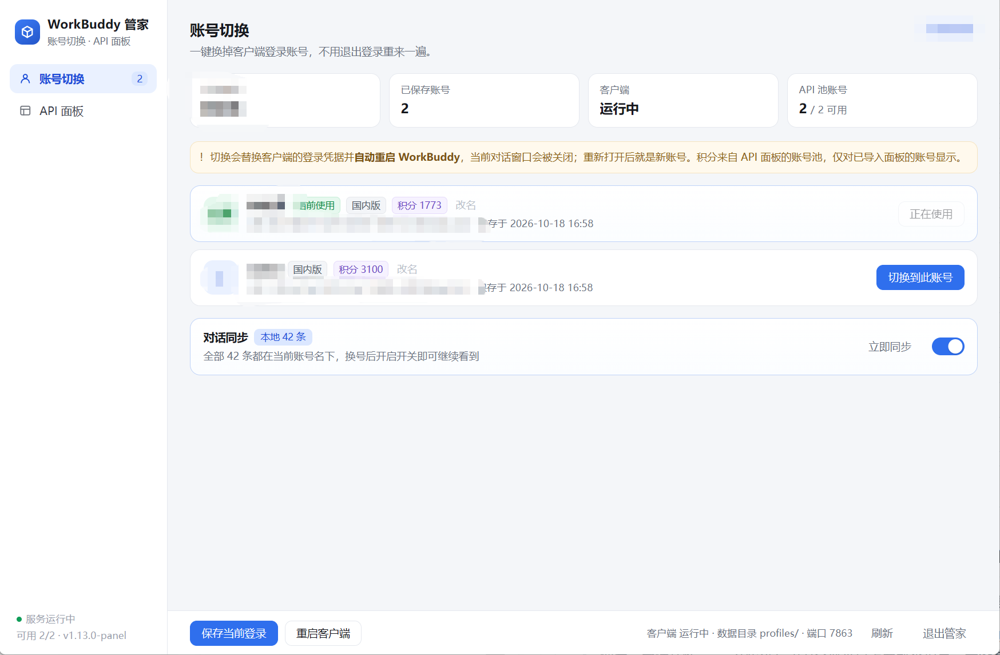

# WorkBuddy 管家（WorkBuddyOne）

> **本项目的底座是 [linguo2625469/workbuddy2api-panel](https://github.com/linguo2625469/workbuddy2api-panel)，那个才是基础。**
>
> 账号池、模型转发、Web 管理面板、OAuth 登录、熔断冷却、签到保活、积分调度、会话粘性
> —— 这些核心能力全部来自上面那个项目，我**没有重写其中任何一块**。
> 它自身又是 [Sliverkiss/workbuddy2api](https://github.com/Sliverkiss/workbuddy2api) 的衍生版。
>
> 我做的事情只有一件：**给 WorkBuddy 桌面客户端加了一个账号一键切换**，
> 顺手把切换器和原来的 API 面板装进同一个进程、同一个窗口，省得开两个程序。

---

## 下载

不想装 Go 自己编译的，直接拿现成的：

**[Releases](https://github.com/3155498108/workbuddy-one/releases)** → `WorkBuddyOne-v1.0.2-win64.zip`（约 4.1 MB）

解压后双击 `WorkBuddyOne.exe` 就能用，**不需要装 Go、Node 或任何运行时**——界面是调用系统自带的
Edge（或 Chrome）以 `--app` 模式显示，Windows 10/11 上本来就有。首次运行会在同目录自动生成
配置和随机 API 密钥。

> exe 没有代码签名，首次运行 Windows 会弹「已保护你的电脑」，点「更多信息 → 仍要运行」即可。

---

## 界面



账号切换页：每张卡片是一个存下来的号，**直接显示它在 API 面板账号池里的积分**（两套数据按
`uid` 关联），右边一颗按钮就换过去。底部是对话同步开关。
（截图里的账号信息已做模糊处理。）

切到「API 面板」时侧栏会收成图标条，把宽度让给原来的面板：

```
左侧导航：账号切换 / API 面板    右上角：当前登录身份
底部状态栏：服务运行中 · 可用 2/2 · 端口 7863
```

---

## 它解决什么问题

`workbuddy2api-panel` 管的是"服务端账号池"——把多个 CodeBuddy 账号变成 OpenAI 兼容 API，
在里面选号是通过模型名前缀 `cn:` / `global:` 自动挑的。

但日常还有另一件事：**在 WorkBuddy 桌面客户端里换号**。
客户端换号必须退出登录、扫一次码、等一遍初始化，切四五个号就是十几分钟。

这个项目就是补上这一块的：把每个号登录后的凭据存成快照，之后一键覆盖 + 重启客户端，
几秒钟完成。**不用 API，也不影响 API 那套。**

---

## 相对上游改了什么

| 位置 | 改动 |
|---|---|
| `cmd/wbone/` | **新增**。桌面版主体：账号切换、统一界面、单实例管理、窗口生命周期 |
| `internal/gwapi/` | **新增**。把上游 `cmd/server` 的 `main()` 抽成可复用的 `Run(ctx, cfgPath, decorate)` |
| `cmd/server/main.go` | 瘦成 10 行薄入口，独立跑网关的行为完全不变 |
| `internal/panel/index.go` | CSP `frame-ancestors 'none'` → `'self'`，`X-Frame-Options: DENY` → `SAMEORIGIN`（面板要能被同源页面内嵌；外部站点仍然嵌不了） |
| `internal/panel/app.js` | 支持从 URL `#key=` 读密钥，桌面版打开面板时免手填 |
| `internal/panel/security_test.go` | 同步上面那条安全头的断言 |

核心思路是**复用同一条 `http.Server`**，用 `decorate` 在外面套一层 `ServeMux`：

```
/                        → 统一界面（账号页 + 面板 iframe）
/accounts/api/*          → 账号切换接口
/v1/*  /panel/*  /healthz → 原样交给上游网关
```

所以只有一个端口（默认 `127.0.0.1:7863`），不需要第二个服务，也不需要跨源 iframe。

---

## 三个功能

### 1. 账号切换（核心）

客户端把登录态存在：

```
%LOCALAPPDATA%\CodeBuddyExtension\Data\Public\auth\<product>.info
```

其中 `account.uid / uin` 是明文，`accessToken / refreshToken / nickname` 是客户端自己的
AES-GCM 信封（`$wbEncrypted`）。所以做法很简单：**整份文件搬运，不解密、不伪造**。

- 保存：把当前 `.info` 复制到 `profiles/<uid>/`
- 切换：先备份当前登录态 → 覆盖目标账号的快照 → 重启客户端
- 只处理国内版（`workbuddy-desktop`），国际版线路不碰
- 客户端会轮换 refresh token，所以每次切换前都会把当前账号重新存一遍，避免旧快照失效

> 注意：面板 `auths/*.json` 里的明文 token **无法**用来伪造客户端登录态。
> 只有真的在客户端里登录过的账号，才能被保存和切换。

### 2. 统一界面

左侧导航两页：账号切换 / API 面板。切到面板时侧栏收成 58px 图标条，
面板顶部多一条工具栏，直接给出接口地址和密钥，一键复制。关窗口即整个程序退出。

### 3. 对话同步（可选，默认关）

WorkBuddy 的对话按账号隔离：`~/.workbuddy/workbuddy.db` 的 `sessions` 表带 `user_id`，
侧栏按当前登录账号过滤，所以换号之后历史看着像"清空"了。

打开开关后，每次切号会把全部**本地**会话的 `user_id` 归到新账号，历史就跟着走。
这是"搬家"不是"复制"——历史只有一份，始终属于当前账号。`transport='cloud'` 的云端会话不动。

改动前会自动备份数据库到 `backup/workbuddy-db-<日期>.db`。

---

## 构建

需要 Go 1.22+（只用 Windows 平台能力，无 CGO）：

```bash
# 桌面版（单文件，约 10MB）
go build -trimpath -ldflags "-H=windowsgui -s -w" -o WorkBuddyOne.exe ./cmd/wbone

# 上游独立的网关（如果你只想要 API）
go build -trimpath -o wb2api.exe ./cmd/server
```

`cmd/wbone/rsrc.syso` 是编译期资源（**图标 + manifest + 版本信息**），别删。
它由 [go-winres](https://github.com/tc-hib/go-winres) 生成，改版本号时照抄这份命令：

```bash
go install github.com/tc-hib/go-winres@latest
cd cmd/wbone
go-winres simply --arch amd64 --out wbone --manifest gui \
  --icon app.ico \
  --product-name "WorkBuddy 管家" \
  --file-description "WorkBuddy 客户端账号切换 + API 面板" \
  --file-version 1.0.2 --product-version 1.0.2 \
  --original-filename WorkBuddyOne.exe \
  --copyright "MIT License"
mv wbone_windows_amd64.syso rsrc.syso
```

两点注意：`--out X --no-suffix` 输出的是**没有扩展名的文件 `X`**（Go 不会把它当资源链接进去），
所以要按上面的写法先生成带后缀的，再改名成 `rsrc.syso`；
同一个目录里**只能有一个 `.syso`**，否则资源重复会导致链接失败。
`app.manifest` 留作参考（Common-Controls / DPI / asInvoker 声明），实际生效的是 syso 里那份。

## 运行

双击 `WorkBuddyOne.exe`，首次运行会在同目录生成 `config.json`（含随机 `sk-` 密钥）、
`profiles/`、`data/`。界面窗口用系统自带 Edge 的 `--app` 模式打开，所以**不需要装任何运行时**，
有 Edge 或 Chrome 即可。

常用操作：

1. 登录客户端 → 点「保存当前登录」→ 换号登录 → 再点一次
2. 之后在卡片上点「切换到此账号」，自动关客户端、换凭据、重新拉起
3. 想用 API 就切到「API 面板」，地址和密钥在顶部工具栏

## 安全

- `profiles/` 里是**可直接登录你账号的凭据文件**（虽然是加密信封，但覆盖回去就能用）。
  不要提交、不要分享、不要传到网盘。`.gitignore` 已排除 `profiles/`、`auths/`、`config.json`。
- 程序默认只监听 `127.0.0.1`，不要改成 `0.0.0.0` 暴露到局域网。
- 对话同步会改写 `workbuddy.db` 的 `user_id` 字段，属于非官方用法，出问题用
  `backup/workbuddy-db-*.db` 还原。介意就别开。

## 致谢与许可

- 底座：[linguo2625469/workbuddy2api-panel](https://github.com/linguo2625469/workbuddy2api-panel) —— 本项目的全部核心能力都来自这里
- 更上游：[Sliverkiss/workbuddy2api](https://github.com/Sliverkiss/workbuddy2api)
- 上游文档完整保留在 [`README.upstream.md`](README.upstream.md)，本项目只在其前面补充了上述改动说明
- 沿用上游的 MIT License，见 [LICENSE](LICENSE)

本项目与腾讯、WorkBuddy / CodeBuddy 官方无任何关联，纯本地工具，自用为主。
